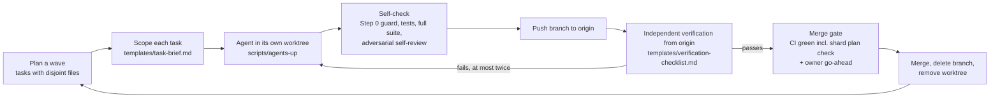

# agent-ops

A small playbook for building software by directing several AI coding
agents in parallel without losing control of the codebase: scoped
briefs, one git worktree per agent, hard rules bound to tests,
independent verification of every branch, and a CI check that proves
every test actually runs.

It is extracted from [a private client project](https://github.com/yildirimgoktug/cleanops-case-study) (a Django/React platform, about
640 commits over six months) that one developer built by running several
Claude Code sessions at once. The product stays private. This repository
holds the way of working: templates, two small scripts, one CI tool, and
short notes on what went wrong.

**Who it is for:** a solo developer or small team already using coding
agents, who wants more than one running at a time and still wants to
trust what gets merged. You can adopt it in an afternoon.

## The loop

The rules that hold the loop together:

- Agents never work on `main`, never open PRs, never merge, never force-push.
- Each brief lists the files the agent owns. Agents in the same wave own
  disjoint files.
- Security rules live in an invariants table. Each row names the code that
  enforces it and the test that fails if it breaks.
- A branch is verified by someone else, from `origin`, before it merges.
  The report is a claim; the branch is the evidence.
- The full test suite runs at the close of every task. A red is a task item.
- When the suite is sharded, CI first checks that every test unit is in
  exactly one shard.

## What is in here

| Path | What it is | Status |
|---|---|---|
| `templates/CLAUDE.md.template` | Agent instructions: workflow, conventions, invariants, definition of done | reconstructed from the project |
| `templates/task-brief.md` | One brief per agent: goal, files in/out of scope, invariants, how it will be verified | adapted |
| `templates/verification-checklist.md` | Pre-merge review, run by someone other than the author | adapted |
| `templates/invariant.md` | The rule-to-test table, with one generic worked example | adapted (example suggested) |
| `scripts/agents-up.sh`, `.ps1` | Create one detached worktree per agent from one base | suggested |
| `scripts/agents-down.sh`, `.ps1` | Remove worktrees; dry run by default, refuses to drop unpushed work | suggested |
| `tools/ci_shard_check/` | Shard plan checker, example project, tests, example workflow | adapted (rewritten) |
| `docs/` | Why worktrees, why plan-check-first, writing briefs, provenance | |

`docs/provenance.md` maps each practice to what the original project recorded.

## Results on the original private project

These numbers come from the project's own docs and commit messages. They
describe one project and are not a benchmark.

- **Test suite:** 6077 backend tests at the serial run, which took 21268 s
  (about 5.9 hours).
- **CI before sharding:** one backend job, killed at 50m22s by its
  50-minute timeout. The required check could never pass.
- **CI after sharding:** first 7 shards, later 13 when the hosted runner
  dropped from 4 to 2 vCPU. On the recorded run all 13 were green and the
  slowest shard took 15m29s, against a 24-minute soft budget. Parity
  checked later on the 13-shard run, when the suite stood at 6078 tests in
  424 modules (6077 at the serial run above), sharded and local, none
  missed, none run twice.
- **What the plan check caught:** the project package, which has no
  `apps.py`, owned 12 security tests and was in no shard. CI had been
  running 6065 tests in 422 modules instead of 6077 in 424.
- **Security invariants:** 12 hard invariants, each with an enforcement
  point and a locking test.
- **Role probes:** 194 read endpoints called as each of 9 roles: zero
  server errors, zero cross-tenant leaks.
- **State machines:** 354 transition attempts against 4 guarded state
  machines: zero illegal transitions allowed.
- **Suite repair:** a full run that had gone red with 51 failures and
  errors was brought back to `Ran 6077 tests ... OK (skipped=4)`, each red
  recorded as repaired, repinned or deleted with a reason. The end-to-end
  suite went from 377 passed / 19 failed to 401 passed / 0 failed.

## Quickstart

1. Copy `templates/CLAUDE.md.template` to `CLAUDE.md` in your repository
   and fill in the placeholders. Delete rules you will not enforce.
2. Write 3 to 5 invariants with `templates/invariant.md`. For each, break
   the rule locally once and watch its test fail.
3. If your suite is sharded, copy `tools/ci_shard_check/` and adapt
   `example-workflow.yml`. The checker needs a plan file: by default
   `<dir>/ci_shards.json` (or pass `--plan`). Start from
   `tools/ci_shard_check/example/ci_shards.json`. Run
   `python tools/ci_shard_check/ci_shard_check.py --root <dir>` locally first.
4. Plan a wave of 2 or 3 tasks that touch disjoint files. Write one
   `task-brief.md` per task.
5. Copy `scripts/` into your repository. Push a shared base branch, then
   create worktrees from inside your repository:
   `scripts/agents-up.sh --base origin/<branch> --dir ../wt task-a task-b`.
   Start one agent session per worktree with its brief. Each agent pushes
   its own branch (`git push origin HEAD:refs/heads/feat/<name>`), never the base.
   The `.ps1` twins are for a PowerShell prompt; pass several names as
   `-Names task-a,task-b`.
6. When an agent reports done, verify its branch from `origin` with
   `templates/verification-checklist.md`, in a separate session or by hand.
7. Merge what passes. Remove the worktrees from step 5 with
   `scripts/agents-down.sh --dir ../wt --yes task-a task-b`.

## Limits and caveats

From the original project's own records:

- **Agents report work as done that is not.** In one round, eight items
  reported as shipped were visibly broken on the test site. In another,
  two delivered items could not be reached by a user. Independent
  verification exists because of this, and it costs real time.
- **Testing only the touched modules hides failures.** For about four
  weeks only touched modules were tested; the first full run found 51
  reds in modules no task had touched. Hence the full-suite close rule.
- **Guards have blind spots.** The shard checker itself missed a
  directory, then a root-level module, before it was right. Measure
  parity; do not trust the guard alone.
- **Worktrees sprawl.** About 100 worktrees and 143 local branches built
  up; 400 unmerged commits had to be archived and verified before
  cleanup. See `docs/why-worktrees.md`.
- **Living docs drift.** The sprint checklist drifted out of date twice
  before "update it in the same branch" became a rule.
- **Briefs are wrong sometimes.** Several briefs stated false premises
  about the code. Agents were asked to check and report, not to follow.
- **Lint never became a gate.** Pre-existing errors meant lint stayed
  informational in CI, managed by a "no new violations" baseline count.
- **Tests that read the clock.** One test failed only on Saturdays and
  Sundays because it planned "today + 2 days" against a one-week board.

What this does not solve:

- Product decisions. Several items stayed blocked on decisions or files
  only the owner could supply; agents cannot unblock those.
- Cost. Several sessions plus a verifier per branch use model time and
  the owner's attention. The project capped fix loops at two iterations
  partly to protect its usage budget.
- Scale. It was used by one developer. It has not been tried with a team.
- The original `CLAUDE.md` was never committed; the template is rebuilt
  from where the project's docs and code quote it.

## Author

Göktuğ Yıldırım, final-year BSc Artificial Intelligence student at
Vrije Universiteit Amsterdam.
GitHub: [yildirimgoktug](https://github.com/yildirimgoktug) · goktugyildirim65@gmail.com

MIT licensed. See `LICENSE`.
